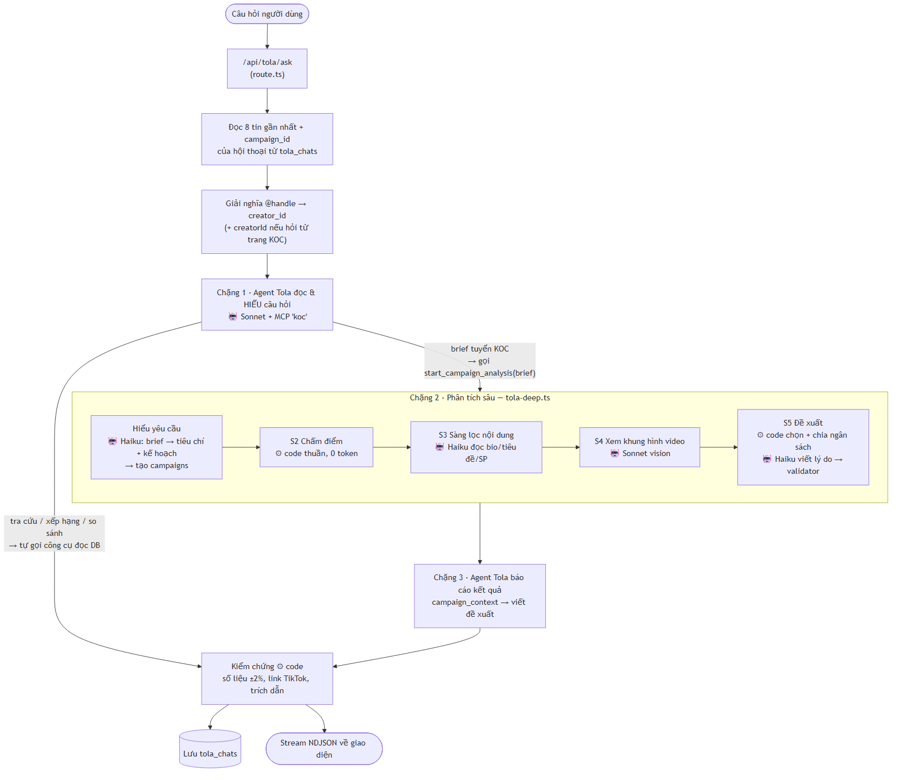
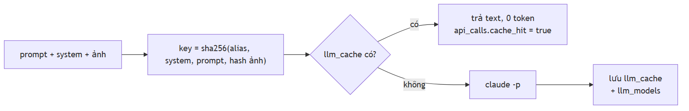

# 02 · Tola AI — cách vận hành

Tola là trợ lý trả lời mọi câu hỏi về KOC bằng **dữ liệu thật trong DB**. Nguyên tắc xuyên suốt:
**code tính số, LLM chỉ đọc – chọn công cụ – diễn đạt**. Con số nào LLM viết ra mà không khớp dữ liệu
đều bị gạch chân "chưa kiểm chứng".

| Nơi hỏi | Gửi lên | Ghi chú |
|---|---|---|
| `/tola`, `/tola/[id]` (`src/components/tola-chat.tsx`) | `{text, threadId}` | ngữ cảnh lấy từ tag `@handle` trong câu |
| Popup ở `/kocs/[id]` — chỉ desktop (`src/components/ask-bar.tsx`) | `{text, threadId, creatorId}` | tự gắn `@handle` của KOC vào câu, luôn mở hội thoại mới; KOC đó coi như đã tag |
| Ô hỏi ở `/kocs` — chỉ desktop (`src/components/tola-ask-bar.tsx`) | chuyển sang `/tola?q=<câu hỏi>` | màn chat tự gửi câu đó; nút phóng to mở `/tola` |
| `/tola?koc=<creatorId>` — mobile: nút Tola ở thanh dưới khi đang xem trang KOC | `{text, threadId, creatorId}` | chip "Đang hỏi về @handle" (bấm × để hỏi chung), gợi ý câu hỏi theo KOC, tự gắn `@handle` |

Cả hai gọi chung route `POST /api/tola/ask` và lưu chung `tola_chats` → lịch sử là một.

---

## 1. Sơ đồ một lượt hỏi

Nguồn sơ đồ: [`diagrams/tola-luot-hoi.mmd`](diagrams/tola-luot-hoi.mmd)

## 2. Chi tiết từng bước

### 2.1 Nhận câu hỏi (`src/app/api/tola/ask/route.ts`)
- `text` cắt 1000 ký tự; `threadId` thiếu thì sinh UUID mới.
- Lịch sử: 8 tin cuối của hội thoại; `campaign_id` của hội thoại được nhớ lại để các lượt sau
  ("bỏ người này đi") vẫn sửa được chiến dịch.

### 2.2 Xác định "đang hỏi về ai" (`src/lib/mentions.ts`) — ⚙ code
- Regex lấy `@handle` → tra `creators.handle` → `{found, missing}` kèm cờ `has_detail`.
- Có `creatorId` (hỏi từ trang KOC) → thêm KOC đó lên đầu và dặn agent: câu không nói rõ ai thì là hỏi
  **riêng** KOC này, không tìm/so sánh người khác trừ khi được yêu cầu.
- Handle không có trong DB → nói thẳng cho agent để không bịa.

### 2.3 Tra cứu hay tuyển KOC — **agent tự quyết** (route 3 chặng)
Không có bước phân loại riêng. Agent Tola đọc câu hỏi (kèm lịch sử) rồi chọn:
- **Tra cứu / xếp hạng / so sánh** ("top 20 KOC doanh thu cao nhất", "ai nhiều follower nhất") → gọi
  công cụ đọc DB (`search_creators`…) và trả lời luôn. Chỉ 1 chặng.
- **Brief tuyển KOC** (sắp chi tiền hợp tác cho sản phẩm: số KOC, ngân sách, khán giả, MCN, review) →
  gọi `start_campaign_analysis(brief)` rồi dừng → **chặng 2** route chạy S2→S5 (§2.4) → **chặng 3**
  gọi agent lần nữa với chiến dịch vừa tạo để báo cáo kết quả.
- Mơ hồ ("tìm 5 KOC tốt") → trả lời như tra cứu, gợi ý cho thêm sản phẩm/ngân sách nếu muốn tuyển.
- `start_campaign_analysis` bị ẩn khi đã có chiến dịch, khi hỏi từ trang hồ sơ KOC (`KOC_NO_DEEP=1`) và ở chặng 3.

> Trước đây (đến 2026-11-03) có bước phân loại riêng: regex + Haiku. Regex bắt nhầm câu xếp hạng
> "Tìm 20 nhà sáng tạo…" thành brief vì có "tìm + số lượng" → bỏ, để agent hiểu câu hỏi.
> Bộ test 6 câu (3 tra cứu, 1 mơ hồ, 2 brief, 1 từ trang KOC) đều đi đúng đường.

### 2.4 Phân tích sâu S2→S5 (khi agent gọi `start_campaign_analysis`)

| Bước | Ai làm | Việc | Ghi ra |
|---|---|---|---|
| Hiểu yêu cầu | 🤖 Haiku (`brief-parser`, `brief-v4`) | brief tự do → ngành, ngân sách, số KOC, tiêu chí, các bước cần chạy | `campaigns` |
| S2 chấm điểm | ⚙ code (`scoring/run.ts`, `s2-v6`) | lọc cứng (thiếu dữ liệu, tài khoản shop, follower, giới tính khán giả, MCN, vượt ngân sách, ít video) → xếp hạng phần trăm trong pool → shortlist `min(60, max(15, 3n))` | `campaign_scores`, `evidence` |
| S3 nội dung | 🤖 Haiku (`s3-content-screen`, `s3-v1`) | mỗi KOC: bio + 10 tiêu đề video + 8 tên SP → ngách, phong cách, độ sâu review, rủi ro. Lô 10 KOC, 3 lô song song | `evidence` (`ai_content`) |
| S4 video | 🤖 **Sonnet vision** (`s4-video`, `s4-v1`) | top `min(10, max(6, 2n))` KOC × 2 video; 1 ảnh ghép 4 khung hình + tiêu đề → có demo SP không, chất lượng, độ tự nhiên. Khung hình tải trước song song | `evidence` (`video_moment`) |
| | ⚙ code | khớp SP (SP gắn > khung hình > tiêu đề); điểm video = 0.4·demo + 0.3·chất lượng + 0.3·tự nhiên; điểm cuối = 0.6·S2 + 0.4·video (chưa xem video → ×0.85) | `campaign_scores` |
| S5 đề xuất | ⚙ code (`s5-recommend.ts`) | chọn: điểm ≥ 55, giá trong trần/KOC, ≤ 2 KOC/MCN, trong tổng ngân sách; chia ngân sách từ mức sàn theo điểm, làm tròn 100k | `campaigns.s5` |
| | 🤖 Haiku (`s5-reasons`, `s5-v1`) | viết 2–3 lý do + 1 lưu ý mỗi KOC, **bắt buộc trích evidence_id** → `validateReasons` loại lý do sai | |

Một bước lỗi chỉ hiện lỗi ở thẻ của bước đó, các bước sau vẫn chạy. Xong thì gửi lại thẻ video chỉ còn
video của các KOC được chọn.

### 2.5 Agent Tola (`src/lib/chat-creator-agent.ts` → `askTola`)
- 🤖 **Sonnet** chạy bằng `claude -p` với MCP server `koc` (`scripts/koc-mcp.ts`) — model tự lên kế hoạch,
  gọi công cụ, đọc kết quả, gọi tiếp (tối đa 24 lượt, timeout 300s). Được phép thêm `WebSearch`/`WebFetch`.
- Ngữ cảnh đưa vào: KOC đang hỏi (mentions), lịch sử, và nếu vừa phân tích sâu thì lệnh "gọi
  `campaign_context` trước rồi báo kết quả thật".
- System prompt: `INTRO_TOLA + RULES`, phiên bản `koc-agent-v5-tola`.

**Công cụ** (`src/lib/koc-data/tools.ts`) — tất cả ⚙ đọc DB, trừ hai cái có 🤖:

| Nhóm | Công cụ |
|---|---|
| Một KOC | `get_overview` (gồm doanh thu/1.000 lượt xem live & video), `list_shops` (cửa hàng KOC hợp tác — tab Cửa hàng), `list_products`, `category_breakdown`, `get_daily`, `get_peers` (gồm lượt xem video 30 ngày so nhóm), `list_videos` (thống kê toàn bộ video: số video không ra đơn, % doanh thu video từ QC trả phí), `analyze_videos` 🤖 (Sonnet vision, tối đa 5 video/lần) |
| Tìm kiếm | `search_creators`, `list_campaigns` |
| Mở phân tích sâu | `start_campaign_analysis(brief)` — không chạy gì trong MCP, chỉ báo route chạy S2→S5 (xem §2.3) |
| Tính toán | `calc` (share / ratio / diff / sum) — chỉ nhận số đã có trong evidence của phiên (±0.5%): số tổng hợp **và số trong hàng bảng** (vd doanh thu từng ngày → cộng được "7 ngày gần nhất") |
| Chiến dịch (chỉ hiện khi hội thoại có chiến dịch) | `campaign_context`, `allocate_budget` (chỉ đề xuất), `exclude_koc`, `update_criteria`, `deepen_koc` 🤖 — ba cái sau sửa chiến dịch rồi chạy lại S5 (và S4 cho `deepen_koc`). Không công cụ nào chạy lại S2 vì sẽ xóa kết quả S3/S4 |

Mỗi lần gọi công cụ tạo một bản ghi `evidence` id `ev_s_<phiên>_<công cụ>_<hash tham số>` chứa
`claim`, `rows`, `numbers`. Giao diện hiện mỗi lần gọi thành một thẻ bước kèm bảng dữ liệu.

### 2.6 Kiểm chứng trước khi trả lời — ⚙ code
- Nguồn số hợp lệ: tóm tắt + số thô + **hàng bảng** của mọi công cụ trong phiên, và chữ các **trang web** agent đã đọc. Số năm (2024, 2025) không cần nguồn.
- Tách tiêu đề và gợi ý hỏi tiếp khỏi markdown.
- `verifyAnswer`: **mọi con số** trong câu trả lời (hiểu đơn vị k/triệu/tỷ/%) phải khớp ±2% với một số
  trong evidence của phiên. Số nguyên < 100 được miễn. Số không khớp → `unverified[]`, UI gạch chân (không xóa).
- Link TikTok có handle không nằm trong dữ liệu phiên → bị gỡ.
- Trích dẫn dạng `[^ev_s_…]` → chip nguồn bấm được, nhảy tới thẻ bước tương ứng.

### 2.7 Lưu & stream
- Luồng trả về NDJSON: `plan` → (`step_add` → `step_start` → `step_done{payload}`)* → `conclusion{markdown, unverified, follow_ups}` → `done{cost_usd}` | `error`.
- Kết thúc (kể cả khi lỗi giữa chừng) → `$push` câu hỏi + câu trả lời (`steps`, `markdown`, `follow_ups`…) vào `tola_chats`; `title` = 80 ký tự đầu câu hỏi đầu tiên.

### 2.8 Phạm vi câu hỏi
| Loại | Tola làm gì |
|---|---|
| Dữ liệu trong DB (KOC, doanh thu, sản phẩm, video, cửa hàng, chiến dịch) | gọi công cụ, trả lời có trích dẫn |
| Trong ngành nhưng ngoài Kalodata (đời tư KOC, quy mô thị trường) | tìm web, ghi rõ "lấy từ web, không nằm trong dữ liệu Kalodata" |
| Dữ liệu chưa thu thập (tab Cửa hàng của KOC chưa crawl, năm cũ) | nói thẳng là chưa có, không suy đoán thành sự thật |
| Ngoài phạm vi (thời tiết, giá vàng…) | không gọi công cụ, không tìm web — từ chối 1-2 câu và gợi ý việc làm được |

## 3. Phân công Code ↔ LLM

| ⚙ Code / DB (0 token) | 🤖 LLM |
|---|---|
| Giải nghĩa `@handle` | Hiểu câu hỏi: tra cứu hay tuyển KOC (agent tự quyết) |
| Lọc cứng, chấm điểm S2, xếp hạng | Hiểu brief → tiêu chí |
| Chọn video, công thức điểm S4, khớp sản phẩm | Đọc nội dung KOC (S3), xem khung hình video (S4, `analyze_videos`) |
| Chọn KOC + chia ngân sách S5 | Viết lý do đề xuất (phải trích evidence) |
| Mọi công cụ đọc DB, `calc` | Agent chọn công cụ nào, gọi theo thứ tự nào |
| Kiểm số ±2%, kiểm link, kiểm trích dẫn, `validateReasons` | Viết câu trả lời markdown cuối |

## 4. Model

Không dùng SDK/API key — mọi lời gọi là tiến trình `claude` CLI (`src/lib/llm/claude.ts`), đường dẫn từ
`CLAUDE_CLI_PATH`. Model truyền bằng **alias** qua `--model`.

| Việc (`api_calls.endpoint`) | Model | Prompt version | Cache |
|---|---|---|---|
| `brief-parser` | haiku | `brief-v4` | `llm_cache` |
| `s3-content-screen` | haiku | `s3-v1` | `llm_cache` + `ai_assessments` |
| `s4-video` (vision) | sonnet | `s4-v1` | `llm_cache` + `ai_assessments` |
| `s5-reasons` | haiku | `s5-v1` | `llm_cache` |
| `tola` (agent) | sonnet | `koc-agent-v5-tola` | **không cache** |

- Lời gọi đơn (`claude()`): `-p --output-format json --tools "" --no-session-persistence --system-prompt …`,
  prompt qua stdin; có ảnh thì dùng `stream-json` với khối ảnh base64. Timeout 240s, thử lại 1 lần khi timeout.
- Agent (`claudeAgent()`): `--output-format stream-json --mcp-config <tmp> --strict-mcp-config
  --allowedTools mcp__koc__*,WebSearch,WebFetch --max-turns 24`. MCP con chạy
  `node --import tsx scripts/koc-mcp.ts` với env `KOC_SESSION`, `KOC_CREATORS`, `KOC_CAMPAIGN`.
- **Chi phí**: mọi lời gọi ghi `api_calls` (`provider: "claude"`, `model_id`, `cost_usd` lấy từ CLI,
  `tokens_in/out`, `latency_ms`, `cache_hit`). Cache hit ghi 0 đồng. Chi phí `analyze_videos`/`deepen_koc`
  chạy trong MCP con được cộng vào `done.cost_usd`.

## 5. Chống bịa (bắt buộc)

1. Mọi con số do code tính từ DB; LLM không tự sinh số.
2. Lý do LLM viết chỉ được trích `evidence_id` có thật — `validateReasons` loại lý do thiếu bằng chứng,
   trích id lạ, hoặc chứa số không có trong bằng chứng được trích.
3. Câu trả lời agent: số không khớp evidence → đánh dấu "chưa kiểm chứng".
4. Độ tuổi/giới tính khán giả và chi phí luôn ghi "ước tính" kèm `confidence` và evidence gốc.

## 6. LLM caching

Nguồn sơ đồ: [`diagrams/tola-cache.mmd`](diagrams/tola-cache.mmd)

| Tầng | Khóa | Dùng cho | Hết hạn |
|---|---|---|---|
| `llm_cache` | `sha256(alias \n system \n prompt \n hash16 từng ảnh)` | mọi lời gọi `claude()` (không gồm agent) | **không** có TTL. Kết quả lỗi không lưu |
| `ai_assessments` | `kind:subject_id:content_hash:model_id:prompt_version` | S3 (`content_screen`, hash bio+video+SP), S4 (`video_analysis`, hash ảnh + tiêu đề) | không xóa; đổi nội dung / model / prompt version → miss |
| `llm_models` | alias → model id đầy đủ CLI báo về | gắn `model_id` cho `ai_assessments`, `api_calls` | cập nhật khi CLI báo id mới |

- Prompt version nằm trong system prompt → sửa prompt là tự đổi khóa `llm_cache`.
- ⚠ `llm_cache` khóa theo **alias**, nên khi Anthropic nâng phiên bản sau alias `haiku`/`sonnet` cache cũ
  vẫn được dùng; `ai_assessments` thì khóa theo model id thật nên sẽ miss.
- Agent **không bao giờ** dùng cache (câu hỏi phụ thuộc lịch sử + dữ liệu thay đổi).
- Xóa cache để test lại: `deleteMany({})` trên `llm_cache` (và `ai_assessments` nếu muốn chạy lại S3/S4);
  hoặc `npm run reset:test -- --yes` (xóa luôn chiến dịch + chat).

## 7. Thử từ terminal

| Lệnh | Việc |
|---|---|
| `npm run tola:eval [-- --set v2]` | **bộ đánh giá** — v1: 27 câu cơ bản; v2: 31 câu đa dạng kiểu hỏi (không dấu, tiếng lóng, tiếng Anh, hỏi nối tiếp nhiều lượt, câu lừa / xin system prompt, KOC chưa có dữ liệu, kỳ không có dữ liệu). v1 (14 về một KOC từ trang hồ sơ, 13 thống kê chung): dữ liệu DB, ngoài dữ liệu (web), ngoài lề, thiếu dữ liệu, tuyển KOC. Tự chấm đường đi / công cụ / nội dung / số thô, ghi `logs/tola-eval-*.md`, tự xoá hội thoại + chiến dịch test. Tốn ~$1,8/lượt. Chạy lại sau mỗi lần sửa prompt. `-- --suite koc|general`, `-- --only K03,G08` |
| `npm run koc:tool` | chạy một công cụ trên dữ liệu thật, không qua LLM |
| `npm run koc:agent` | chạy agent + MCP, in từng lần gọi công cụ |
| `npm run koc:chat` | hỏi đáp từ terminal |
| `npm run bench` | benchmark một chiến dịch từ đầu tới cuối (thời gian, token, chi phí từng bước) |
