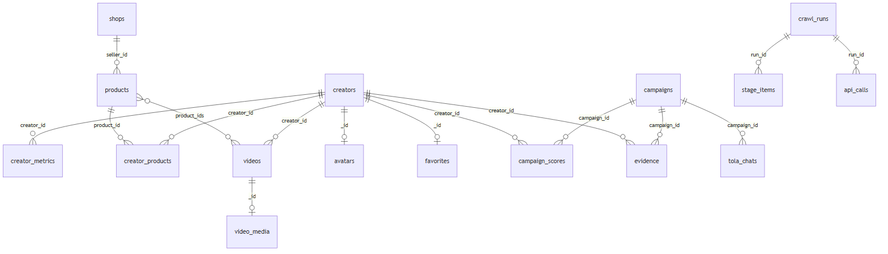

# 03 · Dữ liệu trong MongoDB

Tên collection khai báo tập trung ở `src/lib/db/collections.ts` (object `C`). Kết nối: `src/lib/db/mongo.ts`
(DB = `MONGODB_DB`, mặc định `detola`).

## 1. Setup

### 1.1 Server
- MongoDB 8 chạy trên server `66.42.50.32`, cổng 27017 **chỉ nghe localhost** → truy cập qua SSH tunnel.
- Local dùng cổng **27117** (không phải 27017/27018) để không đụng Mongo cài sẵn trên máy.

```bash
npm run db:tunnel        # ssh -N -L 27117:127.0.0.1:27017 root@66.42.50.32  (giữ terminal mở)
npm run db:ping          # MongoDB ok=1 db=detola collections=N
npm run db:init          # tạo index (ensureIndexes) — chạy lại nhiều lần không sao
npm run db:inspect       # đếm số doc + doc mẫu mỗi collection
npm run db:audit         # kiểm tra độ đầy đủ dữ liệu KOC
```

Windows: `scripts/db-tunnel.ps1 -Install` cài scheduled task `DETOLA-db-tunnel` tự dựng lại tunnel khi rớt.

### 1.2 Biến môi trường
`MONGODB_URI=mongodb://detola:<password>@127.0.0.1:27117/detola?authSource=detola`, `MONGODB_DB=detola`
(đặt trong `.env.local`).

### 1.3 Từ DB trống tới có dữ liệu
1. Tunnel → `db:ping` → `db:init`.
2. `npm run kalo:login` (đăng nhập phiên web Kalodata) → `npm run crawl:web` — xem [04-crawl.md](04-crawl.md).
3. Tùy chọn: `crawl:shops` (tên shop), `avatars` (ảnh đại diện).
4. `db:inspect` / `db:audit` để kiểm tra.

## 2. Sơ đồ quan hệ



<sub>Nguồn sơ đồ: [`diagrams/db-quan-he.mmd`](diagrams/db-quan-he.mmd)</sub>

## 3. Các collection

### 3.1 Dữ liệu crawl (nguồn: Kalodata)

| Collection | 1 document = | Trường chính | Index |
|---|---|---|---|
| `creators` | 1 KOC. `_id` = creator id Kalodata | `handle` (có `@`), `nickname`, `bio`, `followers`, `debut_date`, `audience.{gender_majority, age_buckets_matched, age_majority, raw}`; từ crawl chi tiết: `status`, `region`, `mcn`, `shop_name`, `main_categories`, `product_count`, `contact.{email,zalo,whatsapp,facebook,instagram,line,homepage}`, `detail_updated_at` | `_id` |
| `creator_metrics` | 1 KOC × khoảng ngày × phạm vi ngành hàng | `date_range` (`start~end`), `category_scope` (id ngành hoặc `"all"`), `source`, `revenue`, `sales_volume`, `unit_price`, `views`, `new_followers`, `video_engagement_rate`, `revenue_growth_rate`, `revenue_trend[]`, `views_trend[]`; scope `all` có thêm `video_revenue`, `live_revenue`, `shop_revenue`, `video_views`, `live_views`, `daily[]` | unique `{creator_id, date_range, category_scope}` |
| `products` | 1 sản phẩm | `name`, `seller_id`, `seller_name` | `_id` |
| `creator_products` | 1 KOC × sản phẩm × khoảng ngày | `revenue`, `sales_volume`, `unit_price`, `source` | unique `{creator_id, product_id, date_range}` |
| `videos` | 1 video | `creator_id`, `title`, `publish_date`, `duration_sec`, `content_type`, `product_ids[]`, `views`, `revenue`, `sales`, `gpm`, quảng cáo: `is_ad`, `ad_view_ratio`, `ad_revenue_ratio`, `ad_cost`, `ad_roas`, `ad_cpa`; `is_ai_video` | `{creator_id}` |
| `creator_shops` | 1 KOC × 1 shop hợp tác × khoảng ngày (tab "Cửa hàng") | `seller_id`, `shop_name`, `seller_type` (`BRAND`…), `rank`, `revenue`, `sales`, `live_revenue`, `video_revenue`, `product_count`. `creators.shops_updated_at` đánh dấu đã crawl (kể cả khi 0 shop). Trang KOC chỉ đọc `date_range` mới nhất | unique `{creator_id, seller_id, date_range}` |
| `shops` | 1 người bán | `name`, `seller_type`, `main_category`, `region` | `_id` |
| `avatars` | ảnh đại diện của 1 KOC (`_id` = creator id) | `data` (Binary), `content_type`, `bytes`, `source`, `fetched_at` — lưu bytes vì URL ảnh Kalodata hết hạn sau ~5 phút | `_id` |
| `video_media` | link MP4 phát được của 1 video | `play`, `hdplay`, `cover`, `duration`, `fetched_at` — cache 3 giờ (link CDN có chữ ký, hết hạn) | `_id` |
| `top_kocs` | danh sách top N KOC do `npm run top-kocs` tạo | dùng cho `crawl:web --fill-missing` | — |

> **`creators` bị crawler ghi đè** → mọi thứ người dùng tạo ra (chat, yêu thích) để ở collection riêng.

### 3.2 Vận hành crawl

| Collection | 1 document = | Ghi chú |
|---|---|---|
| `crawl_runs` | 1 lượt crawl (`_id` = runId) | `config`, `candidates[]`, `deep_crawl_ids`, `status` (`locked`/`partial`/…), `halted_reason` |
| `stage_items` | checkpoint 1 việc trong 1 lượt | `run_id`, `stage` (`web:list`, `web:koc`, …), `item_id`, `status` (`pending/running/done/failed`), `attempts`, `error`. Unique `{run_id, stage, item_id}` — dùng để **resume** |
| `raw_responses` | 1 response gốc từ Kalodata (`_id` = hash request) | `endpoint`, `request`, `response`, `credit_cost`, `fetched_at`, `expires_at`. **Là bằng chứng, không bao giờ tự xóa** — `expires_at` chỉ quyết định cache còn tươi không (index thường, không phải TTL) |
| `api_calls` | 1 lần gọi ra ngoài (Kalodata hoặc Claude) | `provider`, `endpoint`, `model_id`, `credit`, `cost_usd`, `tokens_in/out`, `latency_ms`, `cache_hit`, `status`. Crawler đếm collection này để áp trần request/giờ, /ngày |

### 3.3 Chiến dịch & chấm điểm (do Tola phân tích sâu tạo ra)

| Collection | 1 document = | Ghi chú |
|---|---|---|
| `campaigns` | 1 brief tuyển KOC | `prompt`, `brief_llm`, `category_id/name`, `budget_total`, `budget_min/max_per_koc`, `koc_count`, `status` (`confirmed` → `recommended`), tóm tắt `scoring`, `s3`, `s4`, `s5`, `pipeline.stage`, `deep_creator_ids` |
| `campaign_scores` | 1 KOC trong 1 chiến dịch | điều kiện, điểm thành phần, `version`. Chấm lại = xóa rồi ghi lại toàn bộ |
| `evidence` | 1 bằng chứng (1 con số / 1 khoảnh khắc video) | `campaign_id` (`null` nếu là bằng chứng về KOC không gắn chiến dịch, id dạng `ev_koc_<creatorId>_<key>`), `creator_id`, `key`, `type`, `version`. Lý do LLM viết chỉ được trích id ở đây |

### 3.4 AI & hội thoại

| Collection | 1 document = | Ghi chú |
|---|---|---|
| `llm_cache` | 1 prompt đã gọi (`_id` = khóa prompt) | `text`, `model_id`, `created_at` — prompt giống hệt → trả lại, 0 token. Xem [02-tola-ai.md](02-tola-ai.md) §6 |
| `llm_models` | alias → model id thật (`_id` = `"haiku"`, `"sonnet"`…) | `model_id`, `seen_at` — để khóa cache đổi khi model lên phiên bản |
| `ai_assessments` | 1 lần AI phân tích 1 KOC/video | `_id` suy từ `(kind, subject_id, content_hash, model_id, prompt_version)`; `result` |
| `tola_chats` | 1 hội thoại với Tola (`_id` = threadId) | `title`, `messages[]` (`role`, `text`, `markdown`, `steps[]`, `follow_ups`, `unverified`), `campaign_id`, `updated_at`. Dùng chung cho `/tola` và popup ở trang KOC |
| `creator_chats` | hội thoại cũ ở trang KOC (trước khi gộp vào Tola) | không còn ghi mới |
| `favorites` | 1 KOC được gắn sao (`_id` = creator id) | `created_at` |

`categories` có khai báo trong `C` nhưng hiện không có code ghi vào.

## 4. Dọn dữ liệu

| Lệnh | Xóa gì | Giữ gì |
|---|---|---|
| `npm run reset:test` (dry-run) / `-- --yes` | `campaigns`, `campaign_scores`, `evidence`, `stage_items`, `llm_cache`, `ai_assessments`, `creator_chats`, `tola_chats` | toàn bộ dữ liệu crawl, `raw_responses`, `api_calls`, `favorites`, `avatars`. ⚠ mất luôn checkpoint crawl (`stage_items`) |
| `npm run top-kocs -- --n 1000 [--apply]` | KOC ngoài top N (ngành mỹ phẩm `848776`, `848648`; xếp hạng doanh thu 50% / tương tác 30% / view 20%) cùng metrics, products, videos, avatars của họ | **Chạy `mongodump` trước khi `--apply`** |

Chỉ muốn xóa chat + cache LLM để test lại Tola: `deleteMany({})` trên `tola_chats` và `llm_cache`.
