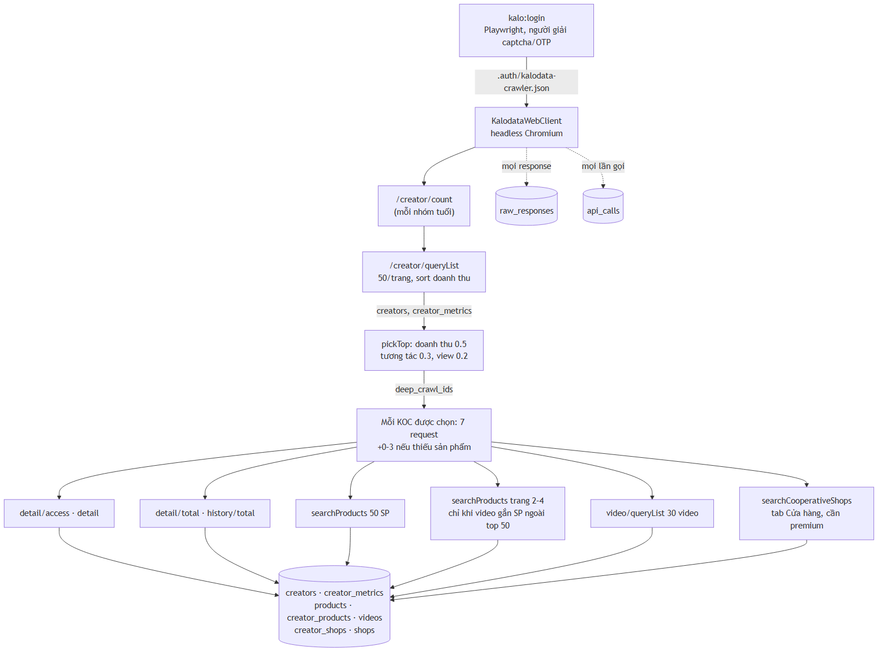

# 04 · Thu thập dữ liệu (crawl Kalodata)

> ⚠ **Open API đang TẮT** (quyết định 2026-11-01). Mọi dữ liệu lấy qua **phiên web** Kalodata
> (`npm run crawl:web`). `KalodataClient` ném lỗi nếu `KALODATA_API_ENABLED` khác `1` — không tự bật.
>
> ⚠ Ngày 2026-11-01 tài khoản crawler **bị khóa** sau ~600 request với nhịp 1 request/1,2 giây. Các
> giới hạn bên dưới được đặt thận trọng vì lý do đó — đừng nới khi chưa cân nhắc.

## 1. Tổng quan



<sub>Nguồn sơ đồ: [`diagrams/crawl-luong.mmd`](diagrams/crawl-luong.mmd)</sub>

- Mã chính: `scripts/crawl-web.ts`, `src/lib/kalodata/web-client.ts`, checkpoint `src/lib/crawl/checkpoint.ts`.
- Mỗi request chạy **bên trong trang Kalodata** (`page.evaluate(fetch(...))`) bằng cookie của phiên, giống
  người dùng thật bấm trên web.

## 2. Đăng nhập

```bash
npm run kalo:login
```
- Mở Chromium có giao diện tới `kalodata.com/login`, điền `KALODATA_WEB_USERNAME`/`PASSWORD`.
- **Người** tự giải captcha/OTP; script chờ tối đa 90 giây.
- Thành công → lưu phiên vào `KALODATA_WEB_SESSION` (mặc định `.auth/kalodata-crawler.json`). Thất bại → ảnh `.auth/login-failed.png`.
- Dùng **tài khoản crawler riêng**, không dùng chung tài khoản đang mở trên trình duyệt.
- Phiên hết hạn → crawler báo lỗi `session` → chạy lại `kalo:login`.

## 3. Chạy crawl

```bash
npm run crawl:web -- [tùy chọn]
```

| Tùy chọn | Mặc định | Ý nghĩa |
|---|---|---|
| `--categories` | `601602` (kem chống nắng mặt) | id ngành, phân tách dấu phẩy. `848776` chăm sóc da, `848648` trang điểm |
| `--ages` | — | nhóm tuổi khán giả, vd `18-24,25-34` |
| `--followers` | — | `10000-1000000`, hoặc `none` = không lọc (shell nuốt chuỗi rỗng) |
| `--pages N\|all` | 1 | số trang danh sách mỗi nhóm tuổi |
| `--top N` | 30 | số KOC được crawl chi tiết |
| `--resume <runId>` | — | chạy tiếp lượt cũ |
| `--extend-top N` | — | (chỉ kèm `--resume`) mở rộng danh sách crawl chi tiết |
| `--until <ISO>` | — | dừng sạch tại thời điểm này, resume được |
| `--fill-missing` | — | chỉ crawl chi tiết KOC trong `top_kocs/top{N}` còn thiếu `detail_updated_at`; **không thêm KOC mới** |

Bộ lọc cố định của danh sách: quốc gia VN, khán giả nữ chiếm đa số, `creator_type=INDEPENDENT`, khoảng 30
ngày kết thúc **hôm qua** (dữ liệu Kalodata trễ 1 ngày).

### Chạy dài ngày (Windows)
```powershell
powershell -ExecutionPolicy Bypass -File scripts/crawl-web-daemon.ps1 -Fill            # chạy 1 lần
powershell -ExecutionPolicy Bypass -File scripts/crawl-web-daemon.ps1 -Fill -Install   # scheduled task DETOLA-crawl
```
- Log ở `logs/`. Lỗi thường → thử lại sau 10 phút.
- `-Fill` = `--fill-missing` rồi chạy `crawl-shops`.
- **Exit code 3 (tài khoản bị cảnh báo/khóa)** → ghi file `.cache/crawl-halted` và **không chạy lại** cho tới khi người xóa file đó.
- **Exit code 4 (chạm giới hạn: trần ngày, Kalodata báo hết lượt/limit, HTTP 429)** → ghi `.cache/crawl-limited` và **dừng hẳn**, không vòng thử lại 10 phút. Chạy tiếp: xóa file đó rồi `Start-ScheduledTask DETOLA-crawl` (crawler tự tính lại phần còn thiếu, không mất tiến độ).

## 4. An toàn & giới hạn

| Biến | Mặc định | Ý nghĩa |
|---|---|---|
| `KALODATA_WEB_INTERVAL_MS` | 5000 | khoảng cách tối thiểu giữa 2 request (≤ 12/phút) |
| `KALODATA_WEB_MAX_PER_HOUR` | 300 | chạm trần → chờ từng 5 phút |
| `KALODATA_WEB_MAX_PER_DAY` | 1200 | chạm trần → **dừng hẳn** (`daily_cap`, exit 4). Không còn chế độ ngủ chờ (`KALODATA_WEB_WAIT_ON_CAP` đã bỏ) |

- Trần đếm trên `api_calls` (chỉ request không trúng cache) → có hiệu lực **xuyên các lượt chạy**.
- Một hàng đợi, tuần tự. Gói web có hạn mức ~1999 lượt xem chi tiết KOC/ngày.
- Thử lại tối đa 3 lần (chờ 3s × lần). Phân loại lỗi theo nội dung:

| Lỗi | Nhận biết | Xử lý |
|---|---|---|
| `halted` (bị khóa) | `locked`, `suspect`, `banned`, `risk control` | dừng ngay mọi request, exit 3, **không thử lại** |
| `session` | `login`, `unauthori`, HTTP 401/403 | dừng, cần `kalo:login` |
| `quota` (bị giới hạn) | `used up`, `upgrade`, `limit`, `too many`, `frequen…`, HTTP 429 | **dừng cả lượt crawl ngay**, exit 4, daemon không tự chạy lại |
| không có dữ liệu | `not found`, `no data` | coi là rỗng |

- **Cache**: response lưu ở `raw_responses` (khóa = sha256 của path + body). TTL 24 giờ, riêng
  `detail/access` và `detail` 7 ngày. Resume / chạy lại trong hạn → **không tốn request mạng**.
- **Checkpoint**: `stage_items` theo từng trang danh sách (`web:list`, item `tuổi|trang`) và từng KOC
  (`web:koc`). Mỗi item thử tối đa 3 lần. Mỗi KOC được crawl **xong trọn** rồi mới sang người tiếp →
  dừng giữa chừng vẫn dùng được dữ liệu.

## 5. Script phụ

| Lệnh | Việc |
|---|---|
| `npm run crawl:video-products [-- --only <id> | --limit N | --resume <id>]` | sản phẩm gắn trong video mà `products` chưa có (nằm ngoài top 50 sản phẩm đã crawl): lấy thêm trang 2→4 của `searchProducts` (≤ 200 sản phẩm/KOC), dừng sớm khi đủ — 0–3 request/KOC. Thiếu bước này thì thẻ hover sản phẩm ở bảng video chỉ có ảnh, không có tên/giá. KOC crawl mới đã tự làm bước này |
| `npm run crawl:creator-shops [-- --limit N \| --resume <id>]` | tab "Cửa hàng" (`/creator/detail/searchCooperativeShops`, cần tài khoản premium) cho KOC đã có chi tiết nhưng chưa có `shops_updated_at` — 1 request/KOC, doanh thu cao trước, cửa sổ 30 ngày của lượt crawl danh sách gần nhất → `creator_shops` + bổ sung tên vào `shops`/`products.seller_name`. KOC crawl mới đã có bước này sẵn (bước thứ 7). Daemon `-Fill` chạy nó sau crawl KOC |
| `npm run crawl:shops -- --max-pages 80` | web `/shop/queryList` (ngành mỹ phẩm, 30 ngày) → `shops`, điền `products.seller_name`. Dừng khi 5 trang liền không có tên mới. Cùng nhịp/trần với crawl KOC |
| `npm run avatars` | tải ảnh từ CDN công khai `img.kalocdn.com/tiktok.creator/<id>/avatar_medium.png` → `avatars` (bytes). Không cần đăng nhập, **không tốn credit**, 500ms/ảnh, chỉ KOC chưa có ảnh |
| `npm run top-kocs -- --n 1000 [--apply]` | giữ top N KOC mỹ phẩm, xóa phần còn lại (backup trước!) |
| `npm run kalo:discover -- <url>` | ghi lại các request JSON của một trang Kalodata vào `.auth/network/calls.json` — dò endpoint mới |
| `npm run kalo:call -- <path> '<json>'` | gọi thử 1 endpoint web. ⚠ **bỏ qua nhịp và không ghi log** → không tính vào trần, dùng ít thôi |

**Video phát được** (`src/lib/tiktok-media.ts`): không phải Kalodata. Khi người dùng bấm play, server
phân giải link qua tikwm (`SHORTFORM_RESOLVER_URL`), cách nhau ≥ 1,1s, cache ở `video_media` 3 giờ.

## 6. Open API (đang tắt — tốn credit)

Chỉ để tham khảo. **Không chạy khi chưa có đồng ý rõ ràng** (nêu endpoint, số lần gọi, credit ước tính, số dư).

- `src/lib/kalodata/client.ts`: header `X-API-Key`, ≤ 90 request/10s, thử lại 4 lần, dùng chung cache `raw_responses`.
- Giá: 1 credit ≈ 0,1 USD; mặc định 0,1 credit/lần; `/rank` 0,1/100 dòng; `video/url` 0,5; `comment/insight` 1. `credit/balance`, `credit/logs` miễn phí.
- Script tốn credit: `npm run crawl` (creator/rank → creator/detail ×2/KOC → product/rank → video/rank), `npm run probe` (category/rank).
- Đặc tả: `docs/kalodata/openapi.json`.
