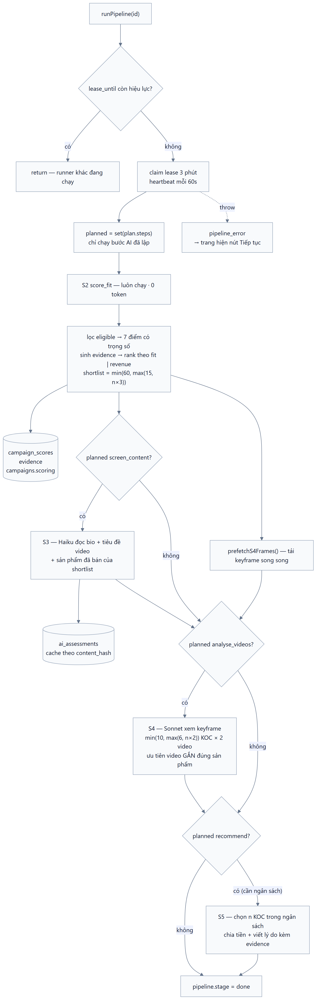
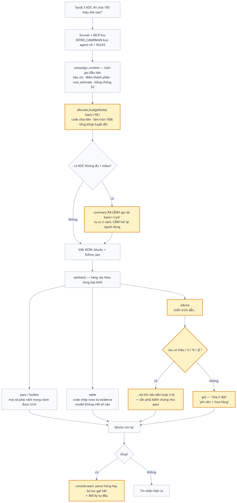

# 11 — Pipeline S2→S5 của một chiến dịch

> **Cập nhật 2026-11-03.** Tài liệu này giờ chỉ còn phần PIPELINE — thứ vẫn chạy y nguyên. Phần giao
> diện của nó (trang `/campaigns`, modal 2 bước brief → xác nhận, chat trên trang chiến dịch với
> `handleTurn`/`RERUN_FROM`) **đã bỏ**: một "chiến dịch" bây giờ sinh ra từ một câu gõ vào trợ lý
> Tola và kết quả trả thẳng trong hội thoại. Xem **[13 — Trợ lý Tola](13-tola.md)**.
>
> Vì vậy các sơ đồ `01-vong-doi`, `02-tao-campaign`, `04-luot-chat`, `06-vong-khep-kin` chỉ còn giá
> trị lịch sử; sơ đồ còn hiệu lực là `03-pipeline`, `07-tola`, `08-tola-luot-hoi`, `09-tola-cong-cu`.

Sơ đồ vẽ bằng Mermaid, nguồn ở `docs/diagrams/*.mmd`, ảnh ở `docs/diagrams/*.png` (và `.svg`).

Sửa sơ đồ thì sửa file `.mmd` rồi render lại:

```bash
npx -y @mermaid-js/mermaid-cli@11 -i docs/diagrams/01-vong-doi.mmd -o docs/diagrams/01-vong-doi.png -c docs/diagrams/theme.json -b white -s 2
```

---

## 1. Pipeline



**Resumable ở hai tầng:** stage-level qua các field `scoring` / `s3` / `s4` / `s5` trong doc chiến
dịch; item-level qua `ai_assessments` và keyframe trên đĩa. `resumeUnfinished()` ở
`instrumentation.ts` tự chạy lại chiến dịch dở khi server khởi động.

Cách S4 **chọn video nào để xem** và cách nó quyết video có đúng sản phẩm hay không:
[12 — S4](12-tim-koc.md#5-s4--xem-video-bước-đắt-nhất-pipelines4-videots).

### Điểm S2 (`scoring/rules.ts`, `s2-v6`)

| Điểm | Mặc định | Có `product_focus` | Nguồn |
|---|---|---|---|
| `performance` | 0,20 | 0,15 | doanh thu + lượt xem, percentile trong pool |
| `content_fit` | 0,25 | **0,35** | bán/nói về đúng sản phẩm chiến dịch |
| `engagement` | 0,15 | 0,12 | 0,7 × tỷ lệ tương tác + 0,3 × **tỉ lệ video nổi bật** |
| `growth` | 0,10 | 0,10 | **xu hướng doanh thu so với kỳ trước** |
| `cost_fit` | 0,10 | 0,08 | chi phí ước tính vs ngân sách/KOC |
| `consistency` | 0,10 | 0,10 | doanh thu dàn đều theo ngày, không một đỉnh |
| `audience_fit` | 0,10 | 0,10 | giới tính / tuổi đa số vs mục tiêu |

**`growth`** đọc `revenue_growth_rate` — có sẵn trên **100%** doc `creator/queryList`, crawl về từ lâu
nhưng trước `s2-v5` không chỗ nào dùng. Lưu ý nó là **tỉ lệ, không phải phần trăm** (0,847 = +84,7%;
−1 = mất sạch doanh thu). Đuôi rất dài (đã thấy +34.334% ở KOC mới có mẫu số gần 0) nên chấm chủ
yếu bằng thứ hạng trong pool, cộng mỏ neo tuyệt đối:

```
growth = 0,7 × percentile(pool) + 0,3 × clamp01(0,5 + rate/2)
```

Mỏ neo để KOC thật sự đang lên được cộng điểm, và KOC đang tụt không ăn điểm cao chỉ vì cả pool
cùng tụt — **trung vị của pool đang là −16,6%**, nên đây là yếu tố phân loại thật: đo trên pool
kem chống nắng, điểm `growth` của shortlist trải **39,6 → 97,8**, trong khi điểm tổng chỉ trải
67,4 → 72,2.

**`breakout_rate`** = tỉ lệ video có lượt xem ≥ 3× trung vị của chính kênh đó (cần ≥ 5 video, dưới
đó trung vị không đáng tin → trả `null`). Đo khả năng tạo video bùng nổ — khác tỷ lệ tương tác (đều
tay) và khác tổng view (phụ thuộc quy mô kênh).

Cả hai sinh bằng chứng riêng, nên agent trích dẫn được:

> Doanh thu đang lên: +12,9% so với kỳ trước (cao hơn 73% KOC đủ điều kiện)
> 5/38 video vượt 3× lượt xem trung vị của kênh (13% video nổi bật; trung vị 11,8k view)

**Ba con số cho cùng chữ "n KOC"** — đừng nhầm:

| | Công thức | n = 5 |
|---|---|---|
| shortlist (S2) | `min(60, max(15, n×3))` | 15 |
| KOC được xem video (S4) | `min(10, max(6, n×2))` | 10 |
| **câu trả lời** | `n` | **5** |

Hai số đầu là khối lượng việc nội bộ. Chỉ số cuối là kết quả giao cho người bán.

---

## 2. Câu hỏi ngân sách: kiểm đầu ra + `allocate_budget`



Phần **kiểm đầu ra** (mọi con số đối chiếu evidence của phiên, link TikTok, dấu trích dẫn) đã dọn
sang [13 — Trợ lý Tola §5](13-tola.md#5-chống-bịa-kiểm-ở-đầu-ra) vì giờ nó áp cho mọi câu trả lời,
không riêng câu ngân sách.

### `allocate_budget`

Code chia tiền, agent chỉ giải thích — đúng nguyên tắc "con số thuộc về code" của S5. Chia theo
`fit` / `revenue` / `cost`, làm tròn 100k, dồn dư vào KOC đầu bảng nên tổng luôn khớp tuyệt đối.
Mỗi dòng đối chiếu với `cost_estimate` của chính KOC đó → chỉ ra ai không đủ tiền cho nổi 1 video.
Không ghi gì vào chiến dịch (đây là phương án tham khảo; S5 mới là bản chốt).

Đo trên 5 KOC thật với 100 triệu:

| basis | đủ 1 video |
|---|---|
| `fit` (mặc định) | 3/5 |
| `cost` | **5/5** |

Khi có KOC hụt tiền, `summary` ra lệnh cho agent gọi lại với `basis='cost'` và tự khuyến nghị, cấm
hỏi lại người dùng.

---
