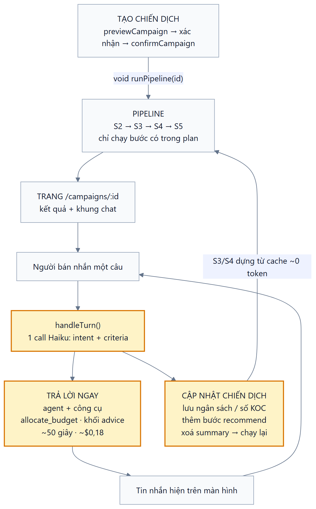
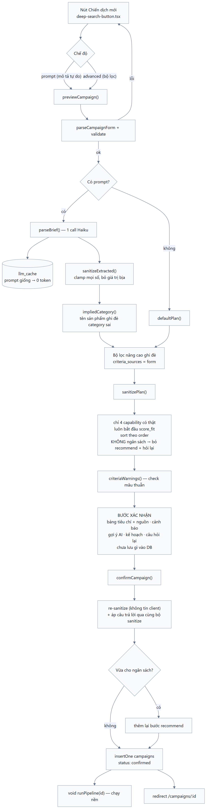
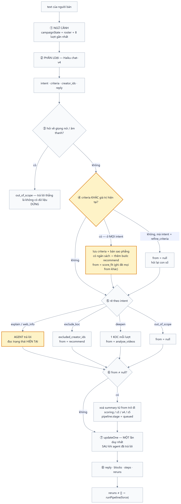
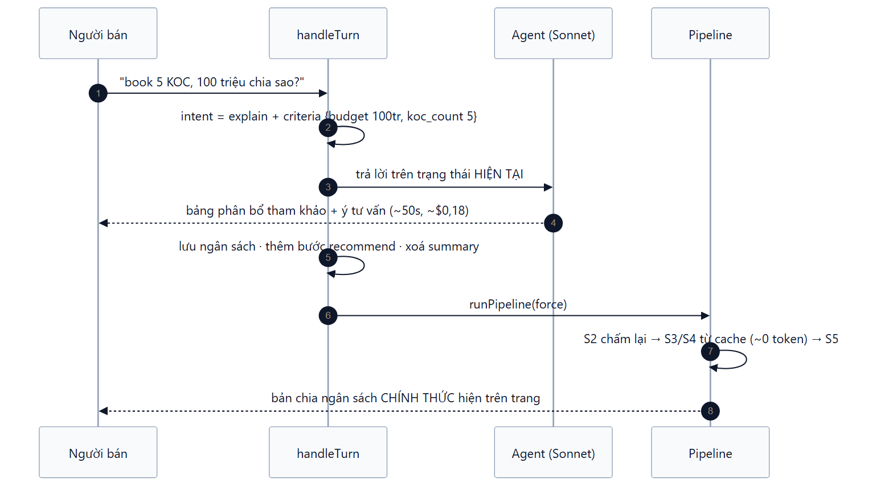

# 11 — Quy trình một chiến dịch

Sơ đồ vẽ bằng Mermaid, nguồn ở `docs/diagrams/*.mmd`, ảnh ở `docs/diagrams/*.png` (và `.svg`).

Sửa sơ đồ thì sửa file `.mmd` rồi render lại:

```bash
npx -y @mermaid-js/mermaid-cli@11 -i docs/diagrams/01-vong-doi.mmd -o docs/diagrams/01-vong-doi.png -c docs/diagrams/theme.json -b white -s 2
```

---

## 1. Toàn cảnh vòng đời



Ô vàng là phần làm lại ở đợt sửa "chat biết tư vấn" (xem §4, §5).

Điểm mấu chốt: **trả lời và cập nhật chiến dịch chạy từ cùng một lượt**. Trước đây chúng loại trừ
nhau — người bán hoặc được trả lời suông (con số họ vừa nói bị vứt đi), hoặc bị chạy lại trong im
lặng mà không có một dòng phân tích nào.

---

## 2. Tạo chiến dịch



Ba điều đáng nhớ:

**AI không được tự quyết gì ngoài ngôn từ.** `parseBrief` chỉ trích xuất; mọi giá trị đi qua
`sanitizeExtracted` (clamp, bỏ số bịa). Kế hoạch đi qua `sanitizePlan` — AI chỉ chọn trong 4
capability có thật và chỉ *đặt tên* bước, phần thực thi vẫn là code.

**Ràng buộc cứng:** không có ngân sách → bước `recommend` bị xoá khỏi plan và hệ thống hỏi lại
(`plan.ts`). Trả lời câu hỏi đó ở bước xác nhận sẽ gắn lại bước này.

**Không lưu gì trước khi xác nhận.** `previewCampaign` thuần tính toán; chỉ `confirmCampaign` mới
`insertOne`. Đổi lại mỗi lần preview tốn một call Haiku, nhưng cache theo prompt nên re-confirm là
0 token.

---

## 3. Pipeline


**Resumable ở hai tầng:** stage-level qua các field `scoring` / `s3` / `s4` / `s5` trong doc chiến
dịch; item-level qua `ai_assessments` và keyframe trên đĩa. `resumeUnfinished()` ở
`instrumentation.ts` tự chạy lại chiến dịch dở khi server khởi động.

### Điểm S2 (`scoring/rules.ts`, `s2-v5`)

| Điểm | Mặc định | Có `product_focus` | Nguồn |
|---|---|---|---|
| `performance` | 0,20 | 0,15 | doanh thu + lượt xem, percentile trong pool |
| `content_fit` | 0,25 | **0,35** | bán/nói về đúng sản phẩm chiến dịch |
| `engagement` | 0,15 | 0,12 | 0,7 × tỷ lệ tương tác + 0,3 × **tỉ lệ video nổi bật** |
| `growth` | 0,10 | 0,10 | **xu hướng doanh thu so với kỳ trước** |
| `cost_fit` | 0,10 | 0,08 | chi phí ước tính vs ngân sách/KOC |
| `consistency` | 0,10 | 0,10 | doanh thu dàn đều theo ngày, không một đỉnh |
| `audience_fit` | 0,10 | 0,10 | giới tính / tuổi đa số vs mục tiêu |

**`growth`** đọc `revenue_growth_rate` — có sẵn trên **100%** doc `creator/queryList`, crawl về từ lâu
nhưng trước `s2-v5` không chỗ nào dùng. Lưu ý nó là **tỉ lệ, không phải phần trăm** (0,847 = +84,7%;
−1 = mất sạch doanh thu). Đuôi rất dài (đã thấy +34.334% ở KOC mới có mẫu số gần 0) nên chấm chủ
yếu bằng thứ hạng trong pool, cộng mỏ neo tuyệt đối:

```
growth = 0,7 × percentile(pool) + 0,3 × clamp01(0,5 + rate/2)
```

Mỏ neo để KOC thật sự đang lên được cộng điểm, và KOC đang tụt không ăn điểm cao chỉ vì cả pool
cùng tụt — **trung vị của pool đang là −16,6%**, nên đây là yếu tố phân loại thật: đo trên pool
kem chống nắng, điểm `growth` của shortlist trải **39,6 → 97,8**, trong khi điểm tổng chỉ trải
67,4 → 72,2.

**`breakout_rate`** = tỉ lệ video có lượt xem ≥ 3× trung vị của chính kênh đó (cần ≥ 5 video, dưới
đó trung vị không đáng tin → trả `null`). Đo khả năng tạo video bùng nổ — khác tỷ lệ tương tác (đều
tay) và khác tổng view (phụ thuộc quy mô kênh).

Cả hai sinh bằng chứng riêng, nên agent trích dẫn được:

> Doanh thu đang lên: +12,9% so với kỳ trước (cao hơn 73% KOC đủ điều kiện)
> 5/38 video vượt 3× lượt xem trung vị của kênh (13% video nổi bật; trung vị 11,8k view)

**Ba con số cho cùng chữ "n KOC"** — đừng nhầm:

| | Công thức | n = 5 |
|---|---|---|
| shortlist (S2) | `min(60, max(15, n×3))` | 15 |
| KOC được xem video (S4) | `min(10, max(6, n×2))` | 10 |
| **câu trả lời** | `n` | **5** |

Hai số đầu là khối lượng việc nội bộ. Chỉ số cuối là kết quả giao cho người bán.

---

## 4. Một lượt chat



Hai thứ tự cố ý đặt như vậy:

**⑤ trước ⑦** — agent phải đọc chiến dịch ở đúng trạng thái người dùng đang nhìn trên màn hình,
không phải trạng thái nửa vời sau khi summary vừa bị xoá để chạy lại.

**`from = score_fit` ở ④ ghi đè mọi `from` khác** — tiêu chí đổi thì điểm đổi, mà `score_fit` là
bước sớm nhất (order 1) nên nó bao trùm cả `recommend` của `exclude_koc` lẫn `analyse_videos` của
`deepen`.

---

## 5. Agent trả lời câu ngân sách


### Kiểm ĐẦU RA, không trói đầu vào

Bản đầu trói đầu vào: model chỉ được trả về các khối cho sẵn (`para` / `bullets` / `table`) và
không được viết số nào trong bảng — code chép hàng từ `evidence`. Chặn được bịa số, nhưng câu trả
lời luôn mang hình hài do giao diện quy định: cùng một bảng `campaign_context` (KOC · điểm · **sáu
điểm thành phần** · ngân sách) hiện ra dù người dùng hỏi về ngân sách hay hỏi vì sao chọn A. Sáu
con số nội bộ đó chiếm nửa bảng và không giúp người bán quyết định gì.

Giờ **model viết markdown tự do**, tự chọn bố cục và cột cho đúng câu hỏi; code kiểm ở đầu ra
(`src/lib/answer-verify.ts`):

| Kiểm cái gì | Cách kiểm | Không đạt thì |
|---|---|---|
| Mọi con số | đối chiếu `numbers` + số trong `claim` của evidence phiên, sai số 2% | gạch đỏ + cảnh báo dưới bài |
| Link TikTok | `@handle` phải nằm trong `rows` của công cụ đã gọi | gỡ link, giữ chữ |
| Link ngoài | phải nằm trong kết quả WebSearch/WebFetch của phiên | ghi log |
| Dẫn chứng | `[^ev_s_...]` do model đặt → chip bấm được, cuộn tới thẻ công cụ | chip không hiện |

Số đếm nhỏ (< 100, nguyên) được miễn — "chia 2 đợt", "top 3", "5 KOC".

Nhờ vậy phần **tư vấn** (cách cấu trúc thanh toán, nên chia mấy đợt, nên hỏi gì trước khi ký) viết
được tự nhiên trong cùng mạch văn, chỉ cần nói rõ đó là kinh nghiệm — trước đây nó bị hàng rào
"mọi ý phải trích bằng chứng" xoá sạch.

### `allocate_budget`

Code chia tiền, agent chỉ giải thích — đúng nguyên tắc "con số thuộc về code" của S5. Chia theo
`fit` / `revenue` / `cost`, làm tròn 100k, dồn dư vào KOC đầu bảng nên tổng luôn khớp tuyệt đối.
Mỗi dòng đối chiếu với `cost_estimate` của chính KOC đó → chỉ ra ai không đủ tiền cho nổi 1 video.
Không ghi gì vào chiến dịch (đây là phương án tham khảo; S5 mới là bản chốt).

Đo trên 5 KOC thật với 100 triệu:

| basis | đủ 1 video |
|---|---|
| `fit` (mặc định) | 3/5 |
| `cost` | **5/5** |

Khi có KOC hụt tiền, `summary` ra lệnh cho agent gọi lại với `basis='cost'` và tự khuyến nghị, cấm
hỏi lại người dùng.

---

## 6. Vòng khép kín của câu hỏi ngân sách



Người bán có câu trả lời trong ~50 giây, rồi con số chính thức tự xuất hiện sau — thay vì bị bảo
"nhắn lại rõ hơn đi".
