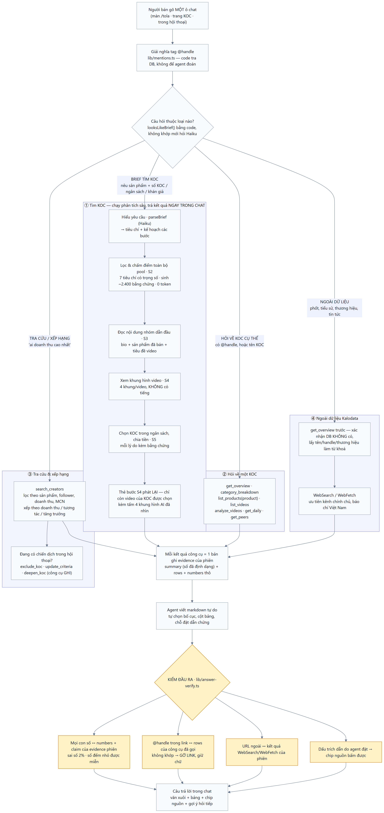
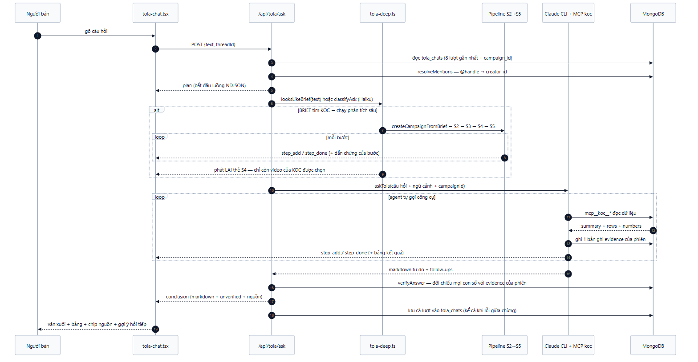
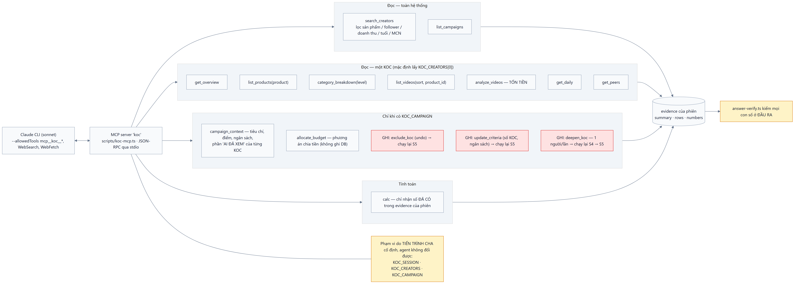

# 13 — Trợ lý Tola: cách vận hành

Tola là **lối vào duy nhất** của sản phẩm: tuyển KOC cho một chiến dịch và hỏi về một KOC đều là một
câu gõ vào cùng một ô chat. Trang `/campaigns` (tạo chiến dịch qua form, xác nhận, rồi xem kết quả ở
một trang riêng) **đã bỏ** — xem §7 để biết cái gì thay thế cái gì.

Tài liệu liên quan: [12 — AI trả lời câu hỏi "tìm KOC"](12-tim-koc.md) đi sâu vào thang điểm và các
ngưỡng của nhánh tìm KOC; [11 — Pipeline S2→S5](11-campaign-flow.md) tả chi tiết pipeline;
[10 — Agent hỏi đáp KOC](10-koc-agent.md) tả nền móng agent + MCP.

Sơ đồ nguồn ở `docs/diagrams/*.mmd`. Render lại:

```bash
npx -y @mermaid-js/mermaid-cli@11 -i docs/diagrams/07-tola.mmd -o docs/diagrams/07-tola.png -c docs/diagrams/theme.json -b white -s 2
```

---

## 1. Bốn loại câu hỏi, một ô chat



Hai nguyên tắc chi phối mọi nhánh:

**Con số thuộc về code, câu chữ thuộc về AI.** AI bóc yêu cầu, đọc nội dung, xem khung hình, viết
nhận định. Lọc, chấm điểm, chọn người, chia tiền là hàm thuần trong `src/lib/scoring` +
`src/lib/pipeline`.

**Kiểm ĐẦU RA chứ không trói đầu vào.** Bản đầu bắt model chỉ được trả các khối cho sẵn và cấm nó
viết số trong bảng — chặn được bịa số nhưng mọi câu trả lời mang cùng một hình hài, và phần *tư vấn*
(nên chia mấy đợt, nên hỏi gì trước khi ký) bị hàng rào "mọi ý phải trích bằng chứng" xoá sạch. Giờ
model viết markdown tự do, `lib/answer-verify.ts` soi lại ở đầu ra (§5).

## 2. Một lượt hỏi đi qua những đâu



Vài điểm không nhìn sơ đồ sẽ không đoán ra:

- **NDJSON chứ không phải Server Action.** Một lượt brief mất 3–5 phút; Server Action không stream
  được nên màn hình sẽ đứng im. Route trả từng dòng sự kiện (`plan` → `step_add` → `step_done` →
  `conclusion`), giao diện dựng thẻ dần.
- **Pipeline chạy trong tiến trình Next, không nằm trong agent.** Tiến trình con của Claude CLI chết
  ngay sau lượt hỏi, pipeline sẽ bị giết giữa chừng. Vì vậy route điều phối S2→S5 *trước*, rồi mới
  để agent đọc `campaign_context` và viết báo cáo.
- **Chỉ số bước của agent bị dời.** Agent tự đánh số từ 0, nhưng các bước pipeline đã chiếm chỗ →
  route cộng `offset`.
- **Thẻ "Xem khung hình video" được phát LẠI sau khi S5 xong**, lần này chỉ còn video của những người
  được chọn. S4 xem 10 KOC để sàng lọc, nhưng người bán chỉ cần bằng chứng cho nhóm họ sắp trả tiền.
  Giao diện gán theo chỉ số bước nên lần phát sau ghi đè lần đầu.
- **Lưu cả khi lỗi giữa chừng**, để phần bước đã chạy vẫn xem lại được.

## 3. Phân loại — nơi dễ hỏng nhất, nên code gác trước

`looksLikeBrief()` (`lib/tola-deep.ts`) nhận brief bằng regex: động từ đi tìm + số lượng KOC, hoặc
ngân sách + từ "KOC". Khớp thì `deep` luôn, **không gọi model** — nhanh hơn, 0 token, tất định.

Hàng rào này tồn tại vì model bấp bênh thật: cùng một câu *"tìm 5 KOC TikTok … ngân sách 30 triệu"*,
một lần Haiku trả `deep`, lần sau trả `quick` — mà `quick` thì cả S2→S5 không chạy và người bán nhận
một câu tra cứu hời hợt thay vì danh sách có bằng chứng. Câu không khớp regex mới hỏi Haiku; Haiku
lỗi thì mặc định `quick` (thà nông còn hơn âm thầm tiêu vài chục cent).

## 4. Bộ công cụ và phạm vi của agent



Phạm vi do **tiến trình cha** cố định qua biến môi trường, agent không tự đổi được:

| biến | ý nghĩa |
|---|---|
| `KOC_SESSION` | mọi bằng chứng rơi vào đúng phiên để validator đối chiếu |
| `KOC_CREATORS` | KOC được nhắc trong câu hỏi — dùng làm **mặc định** khi agent gọi công cụ không truyền `creator_id`. Không còn là danh sách cho phép: từ khi có `search_creators`, agent tự tìm được KOC ngoài danh sách |
| `KOC_CAMPAIGN` | không có thì 5 công cụ chiến dịch **không hiện** trong `tools/list` — agent không thể sửa một chiến dịch nó không đang xem |

Ba công cụ **GHI** (đỏ trong sơ đồ) là những công cụ duy nhất đụng vào DB:

| công cụ | người bán nói | chạy lại | trần |
|---|---|---|---|
| `exclude_koc` (`undo=true` để đưa về) | "bỏ Ánh Ốc, tìm người khác" | S5 | 3 người/lần |
| `update_criteria` | "tôi chỉ có 20 triệu", "cho tôi 8 người" | S5 | chỉ số KOC + 3 mức ngân sách |
| `deepen_koc` | "xem kỹ video của X" | S4 → S5 | 1 người/lần |

Không công cụ nào chạy lại S2: chấm điểm lại sẽ **xoá** kết quả S3/S4 (`scoreCampaign` `$unset` cả
ba). Đổi sản phẩm/ngành/độ tuổi thì phải hỏi một câu mới — route tự nhận ra đó là brief.

Prompt dặn rõ: chỉ gọi khi người bán **thật sự** yêu cầu; thấy nên loại ai thì nói ý kiến rồi để họ
quyết, không tự làm.

### Giới hạn kích thước kết quả công cụ

`toText()` trong `scripts/koc-mcp.ts` có trần **24.000 ký tự** mỗi kết quả, cắt bớt hàng chi tiết
trước và luôn giữ `summary` + `numbers`. Vượt trần thì Claude CLI không đưa kết quả vào ngữ cảnh nữa
mà đổ ra file — agent nhận đúng chữ *"Format: Plain text"* rồi **lặng lẽ đi tìm nguồn khác**, nên
danh sách nó báo cáo khác hẳn danh sách pipeline đã chọn. Dấu hiệu nhận biết trên giao diện: thẻ bước
ghi "Format: Plain text".

Vì vậy `campaign_context` tả **kỹ người được chọn** (gồm phần "AI ĐÃ XEM" từng video) và chỉ **một
dòng** cho người dự phòng.

## 5. Chống bịa: kiểm ở đầu ra

`lib/answer-verify.ts`, chạy sau khi model viết xong:

| Kiểm gì | Cách kiểm | Không đạt thì |
|---|---|---|
| Mọi con số | đối chiếu `numbers` + số trong `claim` của evidence phiên, sai số 2% | gạch chân nhạt + một dòng ghi chú dưới bài |
| Link TikTok | `@handle` phải nằm trong `rows` của công cụ đã gọi | gỡ link, giữ chữ |
| Link ngoài | phải nằm trong kết quả WebSearch/WebFetch của phiên | ghi log |
| Dấu trích dẫn | `[^ev_s_...]` do model đặt → chip bấm được, cuộn tới thẻ công cụ | chip không hiện |

Số đếm nhỏ (< 100, nguyên) được miễn — "chia 2 đợt", "top 3", "5 KOC". Trước khi quét, phần code,
URL và chính các dấu trích dẫn bị lột bỏ để khỏi đếm nhầm.

Gạch chân **nhạt chứ không đỏ**: bản đầu tô đỏ kèm hộp cảnh báo, người bán nhìn tưởng cả bài sai —
trong khi phần lớn ca là số trong câu giả định ("nếu mỗi người quay 2 video thì…").

## 6. Lịch sử hội thoại

`tola_chats`: `{_id, title, campaign_id?, messages[], created_at, updated_at}`. Tiêu đề lấy 80 ký tự
đầu của câu hỏi đầu tiên. Cột trái ở `/tola` (desktop) / drawer (mobile) liệt kê 40 hội thoại mới
nhất.

`campaign_id` được lưu **cả khi chiến dịch sinh ra từ phân tích sâu** — phân tích chạy ở một lượt,
nhưng các lượt sau ("bỏ người này đi") mới là lúc cần sửa nó; không nhớ lại thì agent mất hẳn
`campaign_context` và các công cụ ghi.

## 7. Cái gì thay thế cái gì

| Trước | Nay |
|---|---|
| Trang `/campaigns` + form + bước xác nhận | một câu gõ vào Tola; `looksLikeBrief` quyết định có chạy sâu không |
| `previewCampaign` / `confirmCampaign` | `createCampaignFromBrief()` — tạo thẳng, không có bước xác nhận |
| `handleTurn` + bảng `RERUN_FROM` ở chat chiến dịch | agent gọi công cụ GHI, code chạy lại đúng bước cần |
| `chat-thread.tsx`, `agent-steps.tsx`, `evidence-list.tsx`, `video-evidence.tsx` | `tola-chat.tsx` + `StepCard`/`StepBody` trong `ask-bar.tsx` |
| Khối trả lời định sẵn (`AnswerBlock`) | markdown tự do + kiểm đầu ra |

**Còn một chỗ chưa gộp:** chat ở trang hồ sơ KOC (`/kocs/[id]`) vẫn đi route riêng
`/api/kocs/[id]/ask` với prompt `INTRO_KOC`, không dùng `/api/tola/ask`. Hai bên dùng chung
`runAgent`, `ask-bar.tsx` và bộ công cụ nên không lệch về chất lượng, nhưng vẫn là hai đường.

## 8. File nào làm gì

| File | Việc |
|---|---|
| `src/app/api/tola/ask/route.ts` | điều phối một lượt: mentions → phân loại → pipeline → agent → verify → lưu |
| `src/lib/tola-deep.ts` | `looksLikeBrief`, `classifyAsk`, `runDeepSearch` (chạy S2→S5 và phát thẻ bước) |
| `src/lib/chat-creator-agent.ts` | prompt `INTRO_TOLA` + `RULES`, `askTola`, `runAgent`, tiêu đề thẻ bước |
| `src/lib/koc-data/tools.ts` | 15 công cụ (12 đọc, 3 ghi) + `campaignVideoRows` |
| `scripts/koc-mcp.ts` | MCP server, phạm vi theo env, trần kích thước kết quả |
| `src/lib/mentions.ts` | `@handle` → `creator_id` (code tra DB, không để agent đoán) |
| `src/lib/answer-verify.ts` | kiểm số / link / trích dẫn ở đầu ra |
| `src/components/tola-chat.tsx` | ô chat, luồng NDJSON, thẻ bước đang chạy |
| `src/components/tola-history.tsx` | cột lịch sử (desktop) + drawer (mobile) |
| `src/components/answer-markdown.tsx` | render markdown, chip nguồn, gạch chân số không có nguồn |
| `src/lib/brand.ts` | `AI_NAME = "Tola"` — một nguồn sự thật cho cái tên |

## 9. Kiểm thử nhanh

```bash
# xoá dữ liệu test (chiến dịch, điểm, bằng chứng, cache LLM, hội thoại)
node --conditions=react-server --env-file=.env.local --import tsx scripts/reset-test.ts --yes
```

Gửi thẳng một câu hỏi vào route và đọc từng sự kiện:

```bash
curl -s -X POST http://localhost:3000/api/tola/ask \
  -H 'content-type: application/json' \
  --data-binary @- <<'JSON'
{"text":"tìm 5 KOC bán kem chống nắng, nữ 18-30, ngân sách 30 triệu"}
JSON
```

Mỗi dòng là một JSON; `conclusion.unverified` rỗng nghĩa là mọi con số trong bài đều có nguồn.
Danh sách ca nên thử nằm ở [12 — Chỗ dễ vỡ](12-tim-koc.md#chỗ-dễ-vỡ--nên-đập-vào-đây-khi-kiểm-thử).
